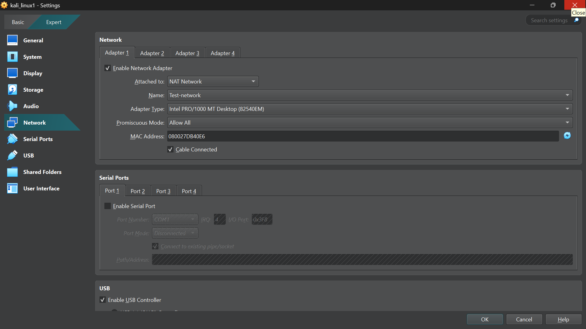
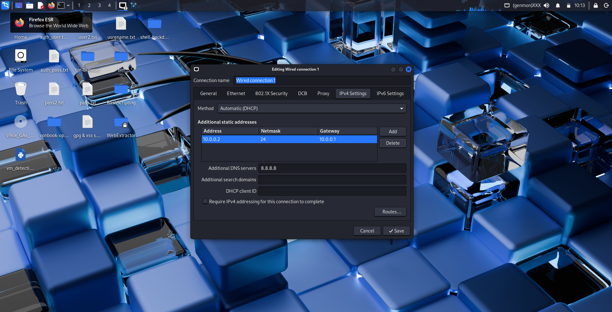

# NETWORKWALKS-B084E-WK1-CYBERSECURITY-LAB-SETUP-SAMPLE
<div align="center">

# 🔐 Cybersecurity Lab Environment Setup

### Building an Isolated Virtual Lab for Penetration Testing and Ethical Hacking

**By Rushan Ansari**


</div>

---

## 📌 Project Overview

This project focuses on setting up a virtual cybersecurity and penetration-testing laboratory using **VirtualBox and Kali Linux**.

The purpose of this lab is to create a controlled environment where cybersecurity tools, network scanning, reconnaissance, vulnerability assessment, and other security-testing activities can be performed safely.

The lab uses a private virtual network so additional virtual machines can be added later for authorized security testing.

## 🎯 Objectives

* Install and configure VirtualBox.
* Set up Kali Linux as a virtual machine.
* Configure a private NAT Network for the cybersecurity lab.
* Configure Kali Linux network settings.
* Assign a consistent IP address to the Kali Linux VM.
* Verify network connectivity and DNS resolution.
* Create a clean virtual machine snapshot.
* Document the setup process for future reference.

---

## 🛠️ Tools and Technologies

| Tool           | Purpose                                     |
| -------------- | ------------------------------------------- |
| VirtualBox     | Virtual machine management                  |
| Kali Linux     | Cybersecurity testing environment           |
| NAT Network    | Communication between virtual machines      |
| Linux Terminal | Network configuration and verification      |
| Nmap           | Network reconnaissance and scanning         |
| GitHub         | Project documentation and progress tracking |

---

## ⚙️ Lab Configuration

| Component                 | Configuration     |
| ------------------------- | ----------------- |
| Host Operating System     | Windows           |
| Hypervisor                | Oracle VirtualBox |
| Security Operating System | Kali Linux        |
| Network Mode              | NAT Network       |
| Network Name              | `Test-network`    |
| Kali Linux IP Address     | `10.0.0.2/24`     |
| Subnet Mask               | `255.255.255.0`   |
| Default Gateway           | `10.0.0.1`        |
| DNS Server                | `8.8.8.8`         |
| Network Range             | `10.0.0.0/24`     |

*Note: These values reflect my current configuration. Connectivity verification is documented separately below.*

---

# 🪜 Lab Setup Procedure

## Step 1. Install 7-Zip

7-Zip was used to extract the Kali Linux virtual machine package if it was provided in `.7z` archive format.

**Tool:** 7-Zip

**Installation steps:**

1. Download 7-Zip from the official website.
2. Run the installer.
3. Complete the installation.
4. Use 7-Zip to extract the downloaded Kali Linux archive if required.

**Download:** https://www.7-zip.org/download.html

## Step 2. Install VirtualBox

Oracle VirtualBox was used as the hypervisor to create and manage the Kali Linux virtual machine.

**Installation steps:**

1. Download VirtualBox from the official website.
2. Run the installer.
3. Follow the installation wizard.
4. Complete the installation and open VirtualBox.

**Download:** https://www.virtualbox.org/wiki/Downloads

## Step 3. Create the NAT Network

A dedicated NAT Network was configured in VirtualBox to provide a private network for the cybersecurity lab.

**Network configuration:**

```text
Network Name: Test-network
IPv4 Prefix:  10.0.0.0/24
DHCP:         Enabled
IPv6:         Disabled
```

**Configuration steps:**

1. Open VirtualBox.
2. Navigate to the network settings.
3. Create a new NAT Network.
4. Set the network name to `Test-network`.
5. Configure the IPv4 network range as `10.0.0.0/24`.
6. Enable DHCP if required for the lab configuration.
7. Save the settings.

A NAT Network allows virtual machines connected to the same network to communicate with each other while supporting outbound network connectivity.

### 📸 Screenshot 3: VirtualBox NAT Network Configuration



---

## Step 4. Import Kali Linux

Kali Linux was configured as a virtual machine in VirtualBox to provide a dedicated environment for cybersecurity learning and authorized penetration testing.

**Configuration steps:**

1. Download Kali Linux from the official website.
2. Extract the archive using 7-Zip if necessary.
3. Open VirtualBox.
4. Import or open the Kali Linux virtual machine, depending on the downloaded format.
5. Configure the virtual machine's memory and network adapter.
6. Start the virtual machine and confirm that Kali Linux loads successfully.

**Virtual machine network configuration:**

```text
Adapter:      Adapter 1
Attached to:  NAT Network
Network:      Test-network
Adapter Type: Intel PRO/1000 MT Desktop
RAM:          2048 MB
```

**Download:** https://www.kali.org/get-kali/

### 📸 Screenshot 4: Kali Linux Desktop


A shared folder can also be configured to transfer files between the host operating system and the Kali Linux virtual machine when required.

---

## Step 5. Configure the Kali Linux Network

The IPv4 settings in Kali Linux were configured to provide a consistent IP address for the cybersecurity lab.

**IPv4 configuration:**

```text
IP Address:   10.0.0.2
Subnet Mask:  255.255.255.0
Gateway:      10.0.0.1
DNS Server:   8.8.8.8
```

**Configuration steps:**

1. Start Kali Linux.
2. Open the network connection settings.
3. Select the active wired connection.
4. Navigate to IPv4 Settings.
5. Configure the required address, subnet mask, gateway, and DNS settings.
6. Save the configuration.
7. Reconnect the network and verify the resulting settings.

These settings are intended to keep the Kali Linux machine consistently addressable within the lab network.

### 📸 Screenshot 5: Kali Linux IPv4 Configuration



---

# 🔎 Lab Verification

After configuring the virtual machine, run the following commands in the Kali Linux terminal to verify the network setup.

| Test                       | Command                     | Expected Result              |
| -------------------------- | --------------------------- | ---------------------------- |
| Check IP address           | `ip a`                      | Correct IP address displayed |
| Test gateway               | `ping -c 4 10.0.0.1`        | Successful replies           |
| Test Internet connectivity | `ping -c 4 8.8.8.8`         | Successful replies           |
| Test DNS resolution        | `nslookup networkwalks.com` | Domain resolves              |
| Verify Nmap                | `nmap --version`            | Nmap version displayed       |

### 📸 Screenshot 7: Network Verification Results

<!-- INSERT YOUR TERMINAL OUTPUT SCREENSHOT HERE AFTER RUNNING THE COMMANDS -->


*Add the screenshot after running the commands and checking the actual results.*

---

## 🐞 Problems Encountered and Solutions

### Problem 1. Internet Connectivity After Static IP Configuration

Manually configuring IPv4 settings may affect Internet connectivity if the address, gateway, or network configuration is incorrect.

**Troubleshooting steps:**

1. Check the IP address using `ip a`.
2. Confirm that the virtual machine is connected to the correct NAT Network.
3. Verify the gateway address.
4. Test gateway connectivity.
5. Check DNS resolution after confirming network connectivity.

Document any additional commands or changes used to resolve the issue.

### Problem 2. VirtualBox Virtualization Error

If the virtual machine fails to start because hardware virtualization is disabled, check the computer's BIOS/UEFI settings.

Possible resolution:

1. Restart the computer.
2. Enter BIOS/UEFI settings.
3. Enable hardware virtualization if it is disabled.
4. Save the changes and restart.
5. Start the virtual machine again.

*These troubleshooting steps should be marked as completed only if the corresponding problem actually occurs and is resolved.*

---

# 💡 What I Learned

Through this setup, I gained practical experience with:

1. **Virtualization:** Using VirtualBox to run Kali Linux in a virtual environment.
2. **Network Configuration:** Configuring a NAT Network for the cybersecurity lab.
3. **IPv4 Addressing:** Understanding IP addresses, subnet masks, gateways, and DNS servers.
4. **Network Verification:** Using Linux commands to inspect interfaces and test connectivity.
5. **Virtual Machine Snapshots:** Creating a recovery point before future security experiments.
6. **Technical Documentation:** Recording configuration details, screenshots, and troubleshooting steps.

---

# 🔐 Security and Ethical Use

This laboratory is intended for educational purposes and authorized security testing only.

All scanning, testing, and experimentation must be performed on systems that I own or have explicit permission to test.

